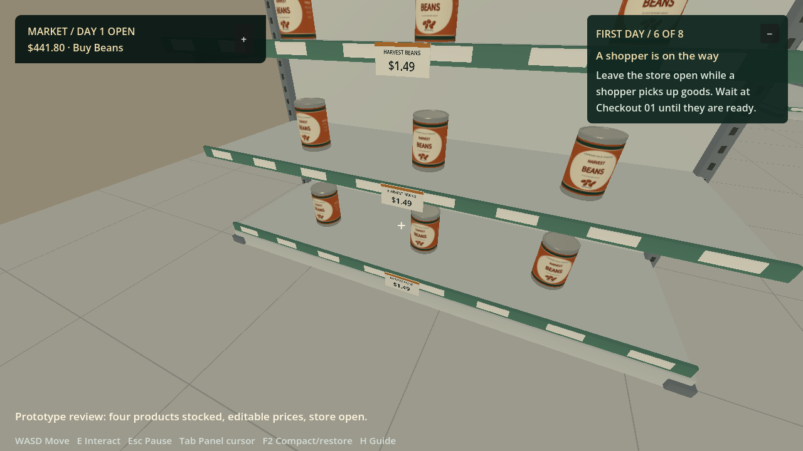
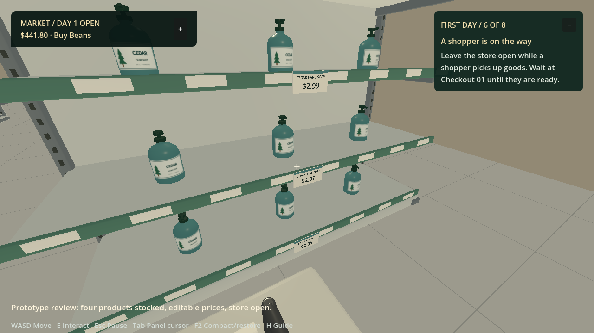
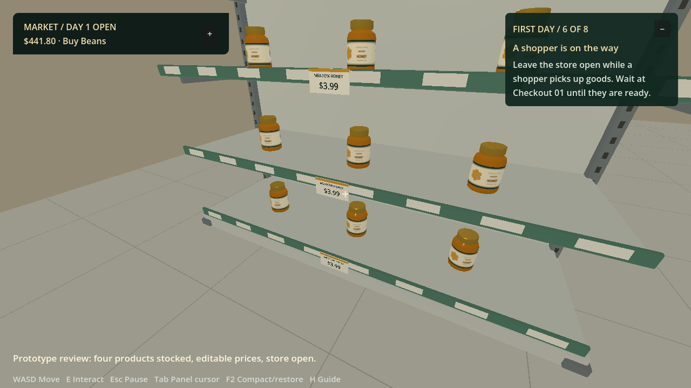
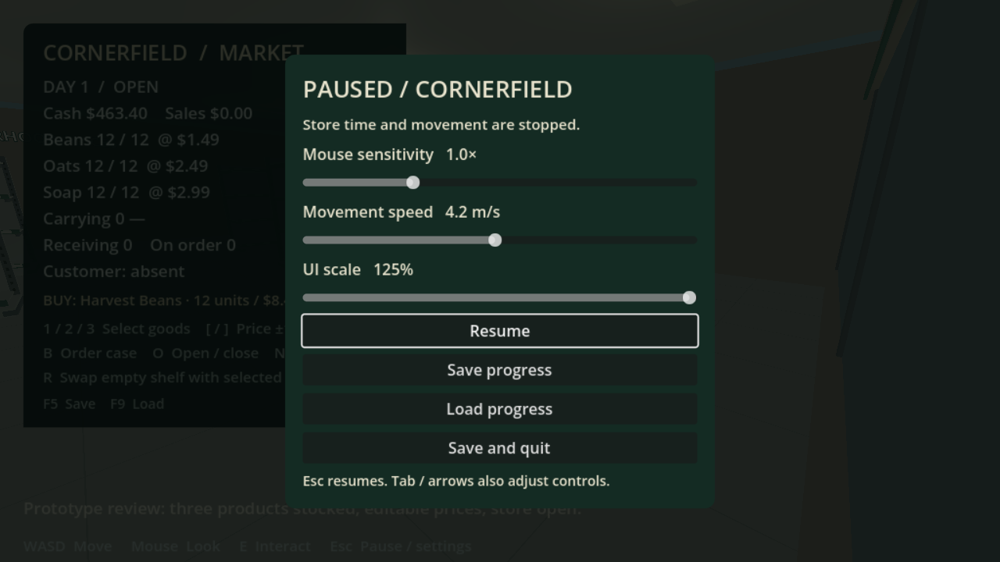
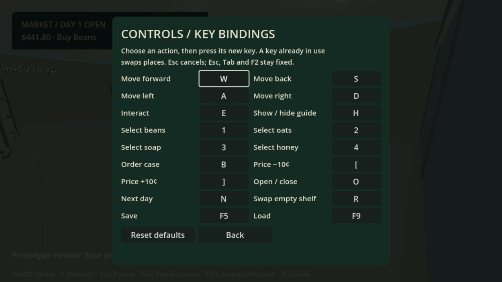

# Cornerfield Market — Retail Store Simulator

A standalone simulator built in **Godot**, with **Houdini** procedural buildings and shelves and a **Blender** checkout. Development uses source files, background generation, headless engine tests and scripted renders. Roblox is the reference; Studio and Rojo are not required for this game.

**Status: playable prototype with saved progress.** Order cases, stock four product shelves, edit prices, serve shoppers and close with a reconciled report. Beans, oats, hand soap and honey have separate stock and costs; one shopper is active at a time. Final art, supporting rooms, staff and multiplayer remain open work.


- [To-do checklist](TODO.md)
- [Detailed handoff for Claude](docs/CLAUDE_HANDOFF.md)
- [GitHub project board](https://github.com/users/Tboy450/projects/2)
- [Design and milestones](docs/REBUILD_PLAN.md)
- [Art pipeline](art/README.md)
- [Background test report](docs/standalone-test-report.json)

## Run

Windows / PowerShell, from this repository:

```powershell
.\scripts\setup-godot.ps1    # pinned official portable Godot 4.7.2
.\scripts\run-game.ps1       # background import, then launch the game
```

The runtime fixture and merchandise GLBs are checked in. Houdini and Blender are needed only to regenerate them. Supply an existing Godot executable with `-Godot C:\path\to\godot_console.exe`.

The local portable build is `builds/CornerfieldMarket-Prototype.zip`. Extract and run `CornerfieldMarket.exe`, keeping its `.pck` beside it. This prototype bundles the official Godot editor runtime in game mode; it is not a size-optimized production export. Build outputs are ignored by Git, not published GitHub releases.

## Play a store day

A first-day guide shows the next useful action and marks Receiving, the matching shelf or Checkout 01 when relevant. It adapts to saved progress and shelf reassignment. **H** hides/shows it; the pause menu remembers your preference. It does not lock normal gameplay and disappears after day one.

1. **1 / 2 / 3 / 4** selects beans, oats, hand soap or honey. **B** orders a twelve-unit case ($8.40 / $13.20 / $15.00 / $21.60). Delivery takes four seconds.
2. Walk to **Receiving**, look toward the table and press **E** to collect the case.
3. Approach the matching **Pantry**, **Breakfast** or **Household** shelf, or the **Spreads** shelf in the middle row behind Pantry, and press **E** to stock it. A case cannot fill a different product's shelf.
4. **[ / ]** adjusts the selected product's sale price by ten cents. Shelf-edge tags on every tier show the goods and their current price. **O** opens; shoppers rotate among stocked goods and walk to Checkout 01.
5. Approach checkout and press **E** to complete the purchase. Baskets retain the price quoted at pickup; the display and receipt show the actual sale.
6. **O** closes and returns unpaid reservations to stock. The report separates revenue, cost of goods, purchases and cash movement. **N** starts the next day.



Stocked goods use original fictional *Cornerfield Pantry* packaging modelled in Blender: a labelled tin of Harvest Beans, a Morning Oats carton, a Cedar Hand Soap pump bottle and a Meadow Honey jar. Each stocked unit is an instance of its product's GLB, standing on the shelf deck with its printed front toward the aisle.





**WASD** moves, the **mouse** looks, and **Esc** opens the pause/settings menu. One sold can leaves **$493.09** from a $500 start after buying an $8.40 case.

While closed, select goods with **1/2/3**, look at a nearby empty shelf and press **R**. Its sign and price tags swap with that product's other empty shelf. Both affected shelves must have no stock or unpaid reservations. Stocking, shopper routes and saved progress follow the new layout.

## Pause and control settings

The dashboard, guide and day report each have **− / +** minimize/restore buttons. The dashboard starts compact, retaining cash, day and selected goods. **F2** compacts/restores all panels. **Tab** enters panel mode and focuses the dashboard button. Arrow keys select visible panels; **Enter / Space** minimizes or restores the selected panel. You can also click the buttons. Press Tab again to return to movement. Store time continues in panel-cursor mode; Esc pauses it. Panel states are remembered separately from store progress.

**Esc** pauses deliveries, shoppers and movement. The menu offers Resume, Save, Load and Save and quit. Sliders adjust mouse sensitivity, movement speed and UI scale (80–125%); Tab and arrow keys work too. A checkbox controls first-day guidance. Preferences are saved separately in `cornerfield-settings.cfg`, so loading store progress does not reset controls. Invalid preferences leave existing defaults unchanged.



**Key bindings** in the pause menu rebinds every gameplay key: movement, interact, goods selection, ordering, prices, open/close, next day, shelf swap, guide, save and load. Choose an action, then press its new key; Esc cancels. A key already in use swaps with the action's previous key, so every action keeps exactly one key. Esc, Tab and F2 stay fixed so pause and panel navigation always work. Keys are stored by physical position, so the defaults stay in place on non-QWERTY layouts and buttons show your layout's printed labels. On-screen hints, prompts, signs and the first-day guide follow your bindings. **Reset defaults** restores the original keys. Bindings save with the other preferences; a settings file with duplicate, fixed or malformed keys is rejected as a whole.



## Saved progress

**F5** saves and **F9** loads. The game loads automatically on startup and autosaves after transactions and normal window close. Files live in Godot's Cornerfield Market user-data folder: `cornerfield-save.json` and its previous valid `.bak`. See [save behavior and recovery](docs/SAVES.md).

Resume starts closed, returns unpaid baskets to their shelves, and preserves shelf assignments, product stock/prices, carried and incoming cases, delivery time, cash, day and daily totals. Version-1 and version-2 saves migrate automatically to version 3: version 1 gains the original shelf layout, and both gain Meadow Honey, empty at its default price on its own shelf. Damaged primaries can recover from backup; failed loads preserve current progress and pause autosaving. Unsupported newer saves are not overwritten.

## Build and verify without editor interaction

```powershell
.\scripts\test-game.ps1             # real engine imports, physics and retail-loop tests
.\scripts\render-game-preview.ps1  # scripted GPU render; no UI automation
.\scripts\package-game.ps1          # portable pack, startup smoke test and ZIP
.\scripts\prepare-game-assets.ps1   # Houdini + Blender background regeneration
```

Verification covers real geometry/materials, physics, trading, save migration/recovery, pause/settings, tutorial progression, panel controls, shelf price tags, key rebinding, packaging import/placement and save migration across catalog changes. Scripted frames are inspected, including the menu and day-end layout at maximum UI scale. Human playtesting, hardware profiling and multiplayer testing remain pending.

## Source layout

| Location | Purpose |
| --- | --- |
| `game/` | Standalone project, gameplay, UI and engine tests |
| `game/assets/generated/` | Versioned GLBs and source/hash manifest |
| `art/houdini/`, `art/blender/` | Procedural architecture and detailed prop sources |
| `art/reference/` | Extracted Roblox v55 geometry and metadata |
| `scripts/*game*.ps1` | Background setup, test, render and packaging |
| `builds/` | Local reports and portable build; ignored by Git |
| `src/`, `plugins/` | Preserved Roblox implementation/integration experiment |

The reference revision is `8b47f52bfb817ede3c7f556cdf503c6f848ddb25`; the static export excludes unsynced Studio edits and live shoppers/vehicles. See [baseline documentation](docs/LEGACY_V55.md), [earlier Roblox plan](docs/ROBLOX_REBUILD_PLAN.md) and [integration experiment](docs/ASSET_IMPORT_TEST.md) for history. A future Roblox port is a separate task.

Godot runtime notices are in `game/GODOT-LICENSE.txt` and `game/GODOT-THIRD-PARTY.txt`. The asset manifest records provenance and scale. No built-in image-generation service is used.
