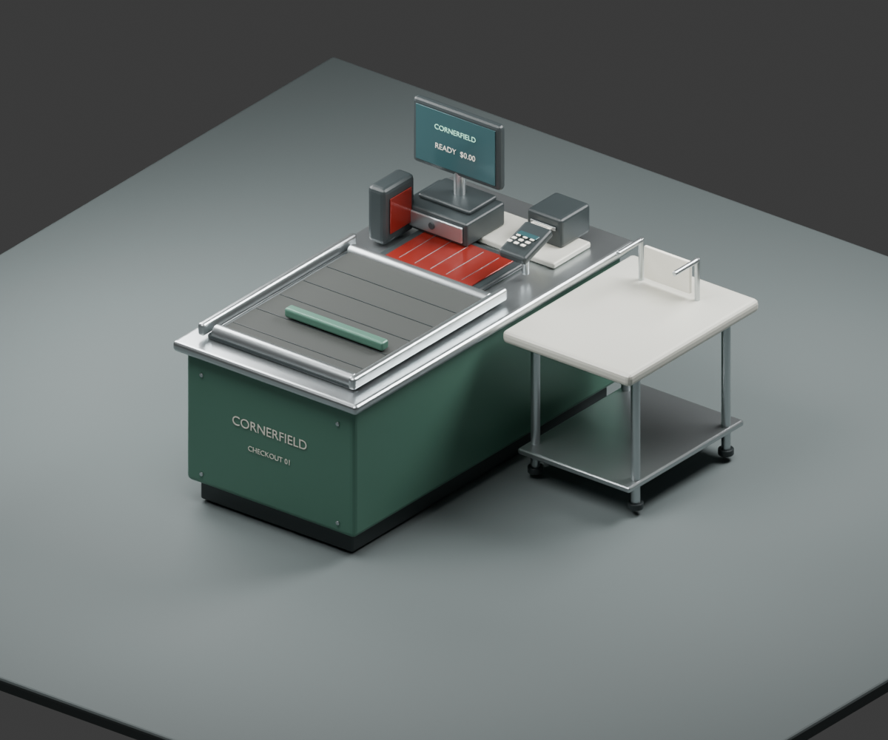

# Retail Store Simulator

A rebuild of the Roblox retail game into a more believable neighborhood discount store. The goal is a detailed store and a satisfying **receive → stock → sell → close → upgrade** loop.

**Status:** pre-production and first model pass. The playable v55 game is the baseline. Replacement art stays separate until imports, collisions and gameplay integration pass review. The finished production game is still to be built.

- [To-do checklist](TODO.md)
- [GitHub project board](https://github.com/users/Tboy450/projects/2)
- [Game design and milestones](docs/REBUILD_PLAN.md)
- [Art pipeline](art/README.md)
- [Store inventory and migration contract](docs/STORE_INVENTORY.md)
- [Legacy setup and full v55 documentation](docs/LEGACY_V55.md)

## Direction

**Cornerfield Market** is the working original identity: muted green signage, warm masonry, powder-coated shelves, tile floors, fluorescent fittings, glass coolers and restrained wear on everyday equipment. Use fictional branding and products. Aim for believable proportions and surfaces that remain readable and efficient on Roblox.

Use **Houdini and Blender together**. Houdini handles procedural construction, repeated shelving, layout variations and scattering. Blender handles detailed props, shape cleanup, UVs and baking. Roblox Studio handles assembly, lighting, collision and gameplay integration. The current prototype uses the installed Houdini 22.0.466 Apprentice environment; keep asset provenance and review usage before changing the project's distribution or commercial scope. See [SideFX licensing](https://www.sidefx.com/Support/licensing/).

## Existing game

The baseline has shelf assignment and stocking, player/NPC checkout, exact change and till accounting, deliveries, open/close behavior, NPC parking and queues, service/cleaning tasks, private bathroom doors and a HUD. Its layout includes bakery, pharmacy, two bathrooms, staff room, office, stock room, cooler, dock, parking, pickup and service yard. Companion systems exist; their place in the new game is undecided.

[The static reference](art/reference/current-store-v55.json) captures blueprint geometry and interaction metadata. It excludes live Studio edits, running shoppers, runtime vehicles and equipped pets. Baseline revision: `8b47f52bfb817ede3c7f556cdf503c6f848ddb25`.

## Run and verify

```powershell
.\setup.ps1                       # if local tools are missing
.\scripts\serve.ps1
```

Connect the Rojo plugin to `localhost:34872` in Studio. Stop Play, then use **Plugins → Retail Game → Update Map**. Press Play to test.

```powershell
.\scripts\test-retail.ps1
.\scripts\build.ps1
.\scripts\export-retail-reference.ps1
```

Build the prototype assets with the commands in [art/README.md](art/README.md). The Houdini starter contains a new parametric shell, removable roof/HVAC, nine shelves and a hidden baseline reference. The separate Blender starter creates a detailed checkout prop, GLB and interaction-anchor manifest. Final modeling, UV/PBR, optimization and live Studio integration remain open work.

The [fixture integration test](docs/ASSET_IMPORT_TEST.md) has its own `asset-test.project.json`, a preparation plugin, separate collision/interaction folders, and a loader that preserves marked imported art. The normal game remains the default. Build the kit with `scripts/build-retail-assets.ps1`; run its separate Rojo server with `scripts/serve-asset-test.ps1` on port **34873**. Actual Studio imports and live play checks are still pending.

## Source layout

| Location | Purpose |
| --- | --- |
| `src/` | Current Roblox game, UI, catalog and v55 map |
| `plugins/` | Studio updater and Rojo plugin |
| `tests/` | Existing Luau regression checks |
| `scripts/` | Build, serve, tests and reference extraction |
| `art/houdini/` | Procedural store and fixture source |
| `art/blender/` | Detailed props and preview source |
| `art/reference/` | Extracted baseline |
| `art/exports/` | Generated models/renders, ignored by Git |
| `docs/` | Design, migration and legacy instructions |

The separate shooter uses `shooter.project.json`; see [its README](shooter/README.md).

## First prop preview



Prototype render; Roblox import and gameplay binding are still pending.

First playable milestone: receive one delivery, stock a shelf, serve a shopper buying real stock, complete checkout, and close with consistent accounts. Prove that loop with two players before expanding management, staff and persistence.
