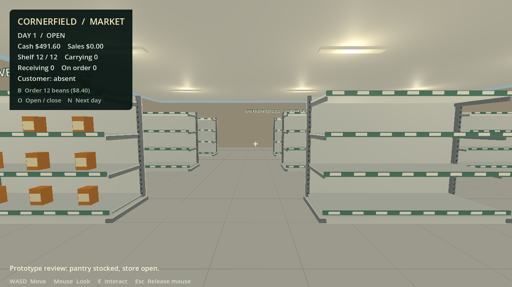
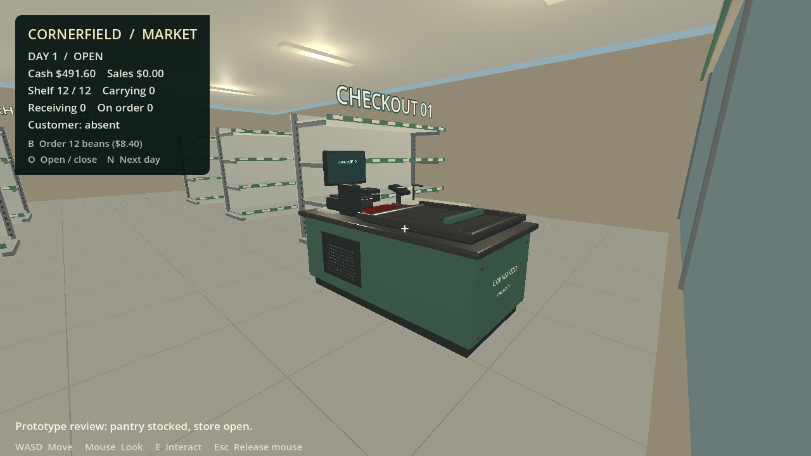

# Cornerfield Market — Retail Store Simulator

A standalone simulator built in **Godot**, with **Houdini** procedural buildings and shelves and a **Blender** checkout. Development uses source files, background generation, headless engine tests and scripted renders. Roblox is the reference; Studio and Rojo are not required for this game.

**Status: first playable prototype.** Order a case, collect it, stock the pantry shelf, open, serve a shopper and close with a reconciled report. One product and one active shopper are implemented. Final art, supporting rooms, saves, staff and multiplayer remain open work.





- [To-do checklist](TODO.md)
- [GitHub project board](https://github.com/users/Tboy450/projects/2)
- [Design and milestones](docs/REBUILD_PLAN.md)
- [Art pipeline](art/README.md)
- [Background test report](docs/standalone-test-report.json)

## Run

Windows / PowerShell, from this repository:

```powershell
.\scripts\setup-godot.ps1    # pinned official portable Godot 4.7.2
.\scripts\run-game.ps1       # background import, then launch the game
```

The three runtime GLBs are checked in. Houdini and Blender are needed only to regenerate them. Supply an existing Godot executable with `-Godot C:\path\to\godot_console.exe`.

The local portable build is `builds/CornerfieldMarket-Prototype.zip`. Extract and run `CornerfieldMarket.exe`, keeping its `.pck` beside it. This prototype bundles the official Godot editor runtime in game mode; it is not a size-optimized production export. Build outputs are ignored by Git, not published GitHub releases.

## Play a store day

1. **B** orders twelve cans of Harvest Beans for **$8.40**. Delivery takes four seconds.
2. Walk to **Receiving**, look toward the table and press **E** to collect the case.
3. Approach the marked **Pantry** shelf and press **E** to stock it.
4. **O** opens. A shopper enters, takes an available item and walks to Checkout 01.
5. Approach checkout and press **E** to complete the **$1.49** purchase.
6. **O** closes and returns unpaid reservations to stock. The report separates revenue, cost of goods, purchases and cash movement. **N** starts the next day.

**WASD** moves, the **mouse** looks, and **Esc** releases/captures the mouse. One sold can leaves **$493.09** from a $500 start after buying an $8.40 case.

## Build and verify without editor interaction

```powershell
.\scripts\test-game.ps1             # real engine imports, physics and retail-loop tests
.\scripts\render-game-preview.ps1  # scripted GPU render; no UI automation
.\scripts\package-game.ps1          # portable pack, startup smoke test and ZIP
.\scripts\prepare-game-assets.ps1   # Houdini + Blender background regeneration
```

Verification covers real imported geometry/materials, collision proxies, character landing, delivery/stock conservation, shopper movement, distance checks, duplicate payments/refunds, day transitions and cash reconciliation. A scripted frame was inspected. Human playtesting, hardware profiling and multiplayer testing are pending.

## Source layout

| Location | Purpose |
| --- | --- |
| `game/` | Standalone project, gameplay, UI and engine tests |
| `game/assets/generated/` | Versioned GLBs and source/hash manifest |
| `art/houdini/`, `art/blender/` | Procedural architecture and detailed prop sources |
| `art/reference/` | Extracted Roblox v55 geometry and metadata |
| `scripts/*game*.ps1` | Background setup, test, render and packaging |
| `builds/` | Local reports and portable build; ignored by Git |
| `src/`, `plugins/` | Preserved Roblox implementation/integration experiment |

The reference revision is `8b47f52bfb817ede3c7f556cdf503c6f848ddb25`; the static export excludes unsynced Studio edits and live shoppers/vehicles. See [baseline documentation](docs/LEGACY_V55.md), [earlier Roblox plan](docs/ROBLOX_REBUILD_PLAN.md) and [integration experiment](docs/ASSET_IMPORT_TEST.md) for history. A future Roblox port is a separate task.

Godot runtime notices are in `game/GODOT-LICENSE.txt` and `game/GODOT-THIRD-PARTY.txt`. The asset manifest records provenance and scale. No built-in image-generation service is used.
